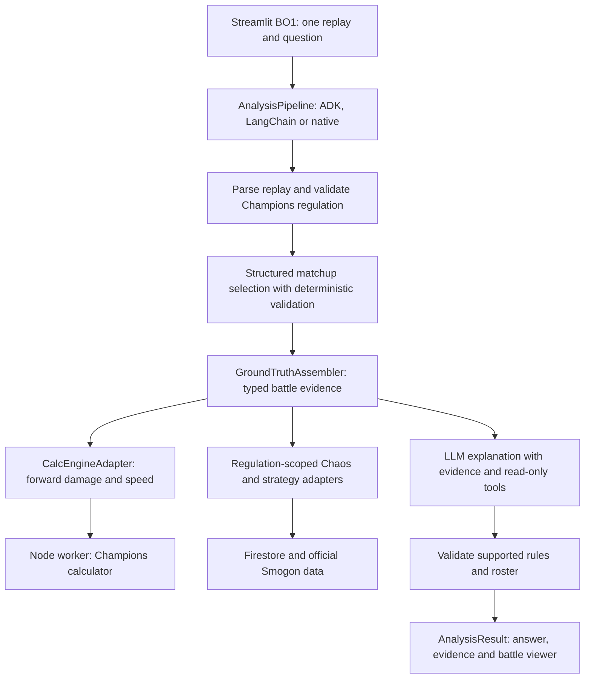
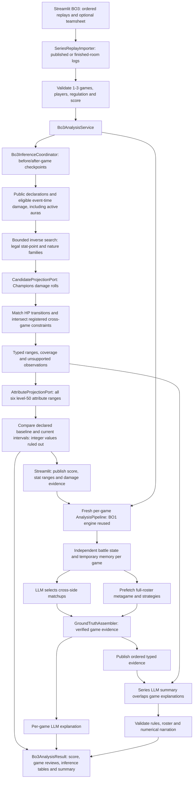
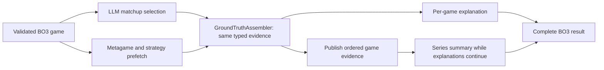

# ProfessorVGC

[](https://github.com/Huarada/professor-VGC/actions/workflows/ci.yml)

Pokemon Champions VGC battle analysis: reconstruct the replay, calculate mechanical
evidence, then explain decisions with an LLM. **Mega Evolution is the only supported
special battle mechanic.** Missing engine support remains an explicit limitation.

## Main features

| Feature | What it does |
|---|---|
| **BO1 review** | Analyze one battle: observed damage, assumed-set damage projections, speed, KO threats and Protect/switch options. |
| **BO3 review** | Import up to three ordered games; track players, score, leads and adaptations. Isolated game reviews run concurrently; two wins end the series. |
| **Reverse spread inference, BO3 only** | Cross compatible damage across registered games using typed attack/stat mechanics; show initial/current intervals and measured reduction. |
| **Battle viewer** | Review each game's battlefield and move-by-move evidence with separate navigation state. |
| **Metagame and team advice** | Add regulation-scoped usage data and strategy context; statistical profiles remain assumptions. |
| **Interchangeable backends** | Google ADK, LangChain or native orchestration; Gemini or OpenAI providers. |

A VGC roster has at most six Pokemon and brings at most four per game. This is
separate from **BO3: best of three games**. BO1 and BO3 are explicit, separate use cases.

## IVs, EVs and Champions stat points

Champions uses **0-32 native stat points per stat, at most 66 total**. IVs are fixed
at **31** and are not inferred. Historical EV-scale transport values are internal
to the calculator integration and must not be presented as native investment.

In BO3, public teamsheets supply declared facts; hidden investment stays unknown.
The solver checks legal profile families against supported damage observations,
accounting for nature, items, abilities, field conditions and HP visibility.
Multiple hits can constrain the same hidden profile. Independent confrontations
are solved separately, using the same engine as the forward damage tool.

The BO3 attribute table also derives **all six level-50 attributes** (HP, Atk,
Def, SpA, SpD and Spe) from compatible native investment bounds and natures.
These are unboosted outer ranges, separate from effective battle modifiers and
assumed-set speed projections. Base and previously observed Mega forms are listed
separately; unrelated range extrema cannot be combined into a single legal set.

Results expose ranges, compatible examples, coverage and unsupported observations.
A bounded search cannot identify an exact spread. Series constraints carry only
with verified registered-team continuity; battle HP, boosts and consumption reset
between games. Private/future information cannot justify earlier decisions.
Supported damage classes include per-target criticals, HP-dependent power,
alternative offensive/defensive stats, fixed damage, speed-based power and logged
multi-hit totals under stable conditions. Attack eligibility never substitutes for
known runtime state; unsupported effects remain explicit. Speed-order inference
and some counter/delayed mechanics remain deferred. Audit the entire installed
move catalog with `npm --prefix node_calc run audit:inverse`.
Details: [methodology](docs/bo3-inference/README.md) and
[example teamsheet](docs/bo3-inference/example-teamsheet.json).

## Architecture

BO1 and BO3 have separate entry points and result models. `Container` injects
infrastructure adapters through domain-owned ports (Clean Architecture). These
arrows show runtime flow, not Python import dependencies.

### BO1: one battle

One replay produces one review. Deterministic damage/speed evidence and labeled
metagame assumptions ground the explanation; reverse spread inference is BO3-only.



### BO3: series analysis and inverse spread inference

A series contains up to three ordered games and ends at two wins. Import is
read-only and makes no model call. Analysis first computes inverse constraints,
then reviews each game through a fresh instance of the shared battle pipeline.
Independent hit tables can use four Node workers. Within each BO3 game review,
metagame and strategy data are prefetched while the model selects matchups.
The series summary starts when every game's typed evidence is ready and can run
alongside the per-game explanations. It never uses generated game answers.
Once inverse inference finishes, BO3 shows its verified score, stat-point
intervals, level-50 attribute ranges and supporting damage citations while the
AI reviews continue. The full-screen loading indicator ends at this point;
an inline status remains until the game and series explanations are ready.
If an explanation fails, the verified evidence stays visible for that attempt.
The submission still uses one daily analysis slot.



### BO3 game-review scheduling

This is the per-game scheduling inside the shared pipeline. The selection model
still runs and is validated; prefetch changes only when the same data is read.
If a selected focus needs data outside the prefetched roster, the assembler
recomputes that context before explaining. BO1 keeps its sequential path.



Registered-team continuity carries compatible set constraints between games;
HP, boosts, item consumption and per-game memory remain isolated. Checkpoints
respect when information became available. Investment uses 0-32 points per stat,
at most 66 total; IVs are fixed at 31. Bounded search results remain uncertain.

Both flows share the parser, regulation guard, Champions Node calculator,
Chaos/strategy adapters and Gemini/OpenAI integrations. The BO3 candidate and
attribute ports use the same calculator engine as forward projections. BO3
spread findings retain game/event/move citations and verified claim plans; the
model explains those results but cannot establish an unmeasured exact spread.
The evidence index is scoped to one series, never to a Pokemon species across
unrelated analyses.

See the [shared infrastructure overview](docs/diagrams/architecture.mmd),
[BO1 Mermaid source](docs/diagrams/bo1-architecture.mmd),
[BO3 Mermaid source](docs/diagrams/bo3-architecture.mmd),
[game-review scheduling source](docs/diagrams/review-prefetch.mmd),
[architecture and source map](docs/architecture.md), and
[browser diagram viewer](docs/architecture-blueprint.html).

## Run locally

Requires Python 3.10+ and Node.js 20+. From the repository root, in PowerShell:

```powershell
python -m venv .venv-windows
.\.venv-windows\Scripts\python.exe -m pip install -r requirements.txt
Push-Location node_calc
npm ci
Pop-Location
if (!(Test-Path .env)) { Copy-Item .env.example .env }
```

Edit `.env` with your provider key, `PROFESSORVGC_FIRESTORE_PROJECT_ID`, and either
`PROFESSORVGC_FIRESTORE_CREDENTIALS_PATH` or Application Default Credentials.
Choose the provider with `PROFESSORVGC_DEFAULT_PROVIDER=gemini|openai` and backend
with `PROFESSORVGC_ORCHESTRATOR=adk|langchain|native`. Use one value for each.
BO3 defaults to three concurrent game reviews, four calculator table workers,
context prefetch during selection, and series-summary overlap. The corresponding
`.env.example` settings can be lowered or disabled on a constrained deployment.
For Gemini BO3, the **Analysis depth** control defaults to **Low** and offers
**Medium** for a more deliberate model explanation. The choice applies to
matchup selection, each game review and the series summary through ADK,
LangChain and native orchestration. It does not change the deterministic damage
engine or stat-point search. OpenAI retains its provider-defined behavior, and
BO1 keeps its existing model settings. Low may reduce latency, but the actual
time and narrative quality depend on the provider response.
The running app reads Chaos data from Firestore; data-loading instructions and
optional Smogon/semantic retrieval are in [DATA.md](DATA.md).

```powershell
python scripts/run_local.py
```

Open **http://localhost:8501**. This Windows environment is separate from any WSL
`.venv`. On Linux/macOS, create an environment with `python3 -m venv .venv` and use
`.venv/bin/python` instead of the Windows executable; copy the configuration with
`cp .env.example .env` only when `.env` does not already exist.

## Analyze a BO3

Select **Best of three**. In **Import BO3**, paste a series-room URL, an uploaded
game replay, or several replay URLs. Review the imported order, public teamsheets
and HP visibility before selecting **Analyze BO3**. Import does not call a model
or consume an analysis slot. Analysis does call the configured provider.

Example series, in game order (Reg M-C):

```text
https://replay.pokemonshowdown.com/gen9championsvgc2026regmcbo3-2702605273
https://replay.pokemonshowdown.com/gen9championsvgc2026regmcbo3-2702606439
https://replay.pokemonshowdown.com/gen9championsvgc2026regmcbo3-2702607924
```

Use regulation `auto` or `mc`. Published replays can be unavailable; import does
not infer missing game IDs. See [import and expired-room recovery](docs/bo3-import.md).
In BO1, paste a replay URL, JSON or log and ask about that individual battle.

## Validation

```powershell
.\.venv-windows\Scripts\python.exe -m pytest -q
.\.venv-windows\Scripts\python.exe -m mypy src
.\.venv-windows\Scripts\python.exe -m scripts.bo3_inference_benchmark.run --out bo3-validation.json
Push-Location node_calc
npm test
npm run smoke
Pop-Location
```

Tests use fakes and the local engine without model keys. The standalone inverse
bench requires the Node worker and fails explicitly if it is unavailable. Its
26 synthetic series / 78 games and 17 independent analytic cases test consistency
and search logic, not held-out real-game spread-identification accuracy.
[Inference results and limitations](docs/bo3-inference/validation/README.md).

Historical log-grounded A/B measurements over 40 games: grounded claims **61.2%
(56.4-65.8%)**, log-only **52.2% (47.1-57.3%)**; odds ratio **1.45 (1.08-1.94)**,
p = 0.013, within ?2 percentage points and ?5% relative tolerance. These measure
those archived explanation runs, not current inverse-inference accuracy.
[Evidence and benchmark history](docs/validation-evidence.md).

### BO3 analysis depth: Low vs Medium (measured)

Matched runs of the full BO3 pipeline (Gemini 3.5 Flash, ADK) on the recorded public series
2709311277: same three replays, 2 questions (stat-spread analysis, turn-by-turn damage), 2 repeats per
depth, order alternated. `python -m scripts.bo3_depth_benchmark --repeats 2` reproduces it; raw runs are
in [depth-benchmark.json](docs/bo3-inference/validation/depth-benchmark.json).

| Metric | Low | Medium |
|---|---|---|
| Wall time, spread question (2 runs) | 59.1 / 32.6 s | 49.2 / 53.3 s |
| Wall time, damage question (2 runs) | 50.3 / 36.9 s | 68.7 / 62.4 s |
| Mean wall time, all 4 runs | **44.7 s** | **58.4 s** (+30%) |
| Mean game-review phase | 29.0 s | 51.6 s |
| Mean series summary | 23.6 s | 38.1 s |
| Damage claims supported by the log (damage question) | 40/59 = 67.8%; 10 claims absent from the log | 39/49 = 79.6%; 5 claims absent from the log |
| Fisher's exact, Low vs Medium, exploratory | odds ratio 0.54 (0.20-1.41), p = 0.20 | |
| Narrative validation rejections (from run logs) | 5 across 3 of 4 runs | 0 |
| Verified bounds identical across depths | yes (same digest in all 8 runs) | yes |
| Known-spread regression (shared deterministic search) | 44/44 logged attacks compatible; reference points retained in all 3 checkpoints | same |

How to read it:

- Low was faster in 3 of the 4 matched pairs and about 14 s faster on average. The first Low run also
  paid the cold-cache inverse search (21 s instead of about 2.5 s), so the Low advantage is slightly
  understated.
- Medium did not prove more accurate (exploratory p = 0.20, 108 extracted claims). Both depths
  produced stat bounds from the same deterministic checkpoint, so the spread intervals never differ.
- The one visible quality signal is that Low triggered the narrative-validation correction loop in 3 of 4
  runs (numerical attributes, a base-form ability assigned to a Mega, malformed claim JSON) and Medium in
  none. The guards caught and corrected each case, and no run fell back to the generic notice, so the
  user-facing result stayed safe. Rejections come from console logs, not the saved JSON.
- Limits: 8 runs, one series, one provider. The spread question yielded only 4 checkable damage claims,
  so the Fisher test uses the damage question. It counts claims absent from the log as failures.
  Claims within the same answer are dependent, so Fisher's independence assumption is unmet and its
  p-value and confidence interval are descriptive only. The checker does not grade strategic reasoning.
  Treat the 14 s as an estimate, not a guarantee. The 89-test recorded-series regression was rerun
  on 13 November 2026; the known spreads were held out from public inference.

## Project documentation

- [Architecture and source map](docs/architecture.md)
- [BO3 inference methodology](docs/bo3-inference/README.md) and [testbench](scripts/bo3_inference_benchmark/README.md)
- [Data and Firestore setup](DATA.md), [configuration](.env.example) and [Docker image](Dockerfile)
- [Architectural decisions](ADR.md) and [project invariants](.claude/CLAUDE.md)
- [Contributing](CONTRIBUTING.md), [security](SECURITY.md) and [Apache License 2.0](LICENSE)


Troubleshooting: [BO3 narration recovery and isolated environments](docs/troubleshooting.md).
