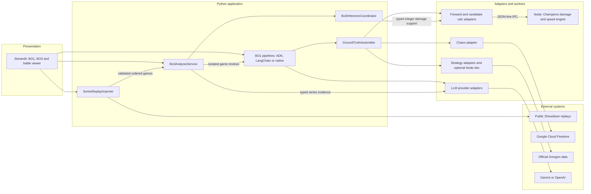

# ProfessorVGC

[](https://github.com/Huarada/professor-VGC/actions/workflows/ci.yml)

Pokemon Champions VGC battle analysis: reconstruct the replay, calculate mechanical
evidence, then explain decisions with an LLM. **Mega Evolution is the only supported
special battle mechanic.** Missing engine support remains an explicit limitation.

## Main features

| Feature | What it does |
|---|---|
| **BO1 review** | Analyze one battle: observed damage, assumed-set damage projections, speed, KO threats and Protect/switch options. |
| **BO3 review** | Import up to three ordered games; track players, score, leads and adaptations. Two wins end the series. |
| **Reverse spread inference, BO3 only** | Use declared nature, item and ability plus eligible observed damage to restrict compatible stat points and natures. |
| **Battle viewer** | Review each game's battlefield and move-by-move evidence with separate navigation state. |
| **Metagame and team advice** | Add regulation-scoped usage data and strategy context; statistical profiles remain assumptions. |
| **Interchangeable backends** | Google ADK, LangChain or native orchestration; Gemini or OpenAI providers. |

A VGC roster has at most six Pokemon and brings at most four per game. This is
separate from **BO3: best of three games**. BO1 and BO3 are explicit, separate use cases.

## IVs, EVs and Champions stat points

Champions uses **0-32 native stat points per stat, at most 66 total**. IVs are fixed
at **31** and are not inferred. Historical EV-scale transport values are internal
to the calculator integration and must not be presented as native investment.

In BO3, public teamsheets supply declared facts; hidden investment stays unknown.
The solver checks legal profile families against supported damage observations,
accounting for nature, items, abilities, field conditions and HP visibility.
Multiple hits can constrain the same hidden profile. Independent confrontations
are solved separately, using the same engine as the forward damage tool.

Results expose ranges, compatible examples, coverage and unsupported observations.
A bounded search cannot identify an exact spread. Series constraints carry only
with verified registered-team continuity; battle HP, boosts and consumption reset
between games. Private/future information cannot justify earlier decisions.
Critical-hit, multi-hit and speed-based inverse inference remain outside the
current delivery. Details: [methodology](docs/bo3-inference/README.md) and
[example teamsheet](docs/bo3-inference/example-teamsheet.json).

## Architecture

Runtime interactions are shown below; these arrows are calls, not source-code
import rules. `Container` wires concrete adapters behind domain-owned ports.



All backends share deterministic evidence. The BO3 coordinator adds inverse
inference and isolated game reviews before synthesizing typed series evidence;
generated per-game prose is not the synthesis's source of truth.

See [architecture and BO3 flow](docs/architecture.md), the
[browser diagram viewer](docs/architecture-blueprint.html), and
[Mermaid sources](docs/diagrams/).

## Run locally

Requires Python 3.10+ and Node.js 20+. From the repository root, in PowerShell:

```powershell
python -m venv .venv
.\.venv\Scripts\python.exe -m pip install -r requirements.txt
Push-Location node_calc
npm ci
Pop-Location
if (!(Test-Path .env)) { Copy-Item .env.example .env }
```

Edit `.env` with your provider key, `PROFESSORVGC_FIRESTORE_PROJECT_ID`, and either
`PROFESSORVGC_FIRESTORE_CREDENTIALS_PATH` or Application Default Credentials.
Choose the provider with `PROFESSORVGC_DEFAULT_PROVIDER=gemini|openai` and backend
with `PROFESSORVGC_ORCHESTRATOR=adk|langchain|native`. Use one value for each.
The running app reads Chaos data from Firestore; data-loading instructions and
optional Smogon/semantic retrieval are in [DATA.md](DATA.md).

```powershell
.\.venv\Scripts\python.exe -m streamlit run src/ui/app.py
```

Open **http://localhost:8501**. On Linux/macOS, use `.venv/bin/python` instead of
the Windows virtual-environment executable; copy the configuration with
`cp .env.example .env` only when `.env` does not already exist.

## Analyze a BO3

Select **Best of three**. In **Import BO3**, paste a series-room URL, an uploaded
game replay, or several replay URLs. Review the imported order, public teamsheets
and HP visibility before selecting **Analyze BO3**. Import does not call a model
or consume an analysis slot. Analysis does call the configured provider.

Example series, in game order (Reg M-C):

```text
https://replay.pokemonshowdown.com/gen9championsvgc2026regmcbo3-2702605273
https://replay.pokemonshowdown.com/gen9championsvgc2026regmcbo3-2702606439
https://replay.pokemonshowdown.com/gen9championsvgc2026regmcbo3-2702607924
```

Use regulation `auto` or `mc`. Published replays can be unavailable; import does
not infer missing game IDs. See [import and expired-room recovery](docs/bo3-import.md).
In BO1, paste a replay URL, JSON or log and ask about that individual battle.

## Validation

```powershell
.\.venv\Scripts\python.exe -m pytest -q
.\.venv\Scripts\python.exe -m mypy src
.\.venv\Scripts\python.exe -m scripts.bo3_inference_benchmark.run --out bo3-validation.json
Push-Location node_calc
npm test
npm run smoke
Pop-Location
```

Tests use fakes and the local engine without model keys. The standalone inverse
bench requires the Node worker and fails explicitly if it is unavailable. Its
26 synthetic series / 78 games and 17 independent analytic cases test consistency
and search logic, not held-out real-game spread-identification accuracy.
[Inference results and limitations](docs/bo3-inference/validation/README.md).

Historical log-grounded A/B measurements over 40 games: grounded claims **61.2%
(56.4-65.8%)**, log-only **52.2% (47.1-57.3%)**; odds ratio **1.45 (1.08-1.94)**,
p = 0.013, within ?2 percentage points and ?5% relative tolerance. These measure
those archived explanation runs, not current inverse-inference accuracy.
[Evidence and benchmark history](docs/validation-evidence.md).

## Project documentation

- [Architecture and source map](docs/architecture.md)
- [BO3 inference methodology](docs/bo3-inference/README.md) and [testbench](scripts/bo3_inference_benchmark/README.md)
- [Data and Firestore setup](DATA.md), [configuration](.env.example) and [Docker image](Dockerfile)
- [Architectural decisions](ADR.md) and [project invariants](.claude/CLAUDE.md)
- [Contributing](CONTRIBUTING.md), [security](SECURITY.md) and [Apache License 2.0](LICENSE)
