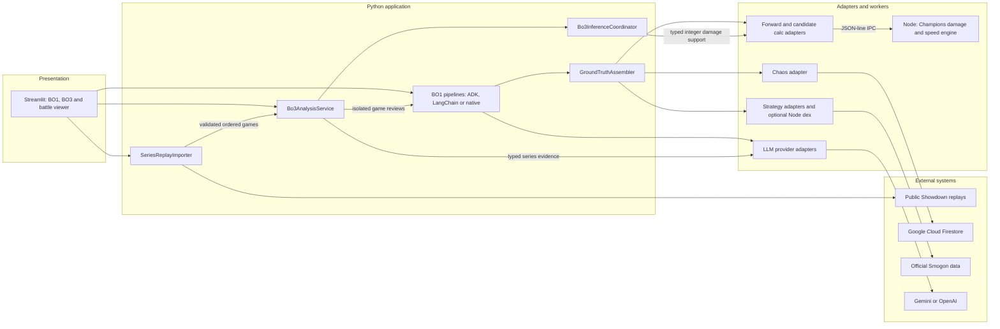
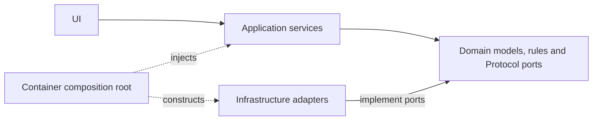
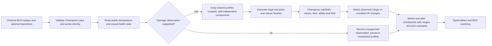

# Architecture

Current source view: 2026-10-25. ProfessorVGC is a modular Python application with
Node subprocesses, packaged together for deployment. BO3 inference is a supporting
bounded context inside that application, not a separate deployed service.

## Runtime interactions

Arrows show calls between components and external systems, not import direction.
The Streamlit viewer consumes parsed replay snapshots. The importer reads published
Showdown data and validates order before analysis; it does not invoke an LLM.

BO1 pipelines share `GroundTruthAssembler` for deterministic evidence. Selection
and explanation are separate model stages; ADK/LangChain explanation agents can
use read-only `damage_calc`, `chaos_meta_stats` and `smogon_strategy` tools.
The native backend calls the provider directly. BO3 runs its inference stage,
creates fresh game pipelines, and synthesizes typed evidence through `LLMProvider`.
Neither its final summary nor its numeric tables are inferred from generated prose.

The worker hosts both the forward calculator and candidate-support commands.
Reverse inference reuses the same Champions engine through `CandidateProjectionPort`.
`calcRolls` skips description and KO-analysis overhead. A separate Node dex worker
can retrieve optional official Smogon data. Chaos usage and enabled quota storage
use Firestore; a bounded local index stores verified public series links, not
private replay content. Ephemeral local caches do not imply cloud durability.

## Dependency direction

| Responsibility | Source |
|---|---|
| Game/series contracts, Champions rules and ports | `src/domain/models.py`, `series.py`, `champions.py`, `interfaces.py` |
| Inference contracts, legal families, HP compatibility and graph components | `src/domain/bo3_inference/` |
| BO1 evidence and interchangeable orchestration | `src/services/ground_truth.py`, `analysis_service.py`, `adk_orchestrator.py`, `langchain_orchestrator.py` |
| BO3 orchestration and isolated game sessions | `src/services/series_analysis.py` |
| Reverse search, local proofs, component solving and checkpoints | `src/services/bo3_inference/` |
| Public series acquisition and remembered public links | `src/services/series_import.py`, `src/adapters/showdown_series_gateway.py`, `src/adapters/series_replay_index.py` |
| Replay parsing and viewer snapshots | `src/adapters/parsers/showdown_log/` |
| Forward/candidate engine adapters, teamsheets and model tools | `src/adapters/calc/`, `teamsheet/`, `llm/evidence_tools.py` |
| Shared mechanics and JSON-line worker dispatch | `node_calc/src/calcEngine.js`, `candidateSupport.js`, `node_calc/calc_server.js` |
| Composition and presentation | `src/services/container.py`, `src/ui/` |

Domain code has no adapter or service dependency. Services consume domain ports;
`Container` is the composition root that knows concrete adapters. The UI invokes
application use cases and renders typed results. Ports and Adapters separates
external formats; immutable value objects/checkpoints, candidate factories and
memoized projections preserve the same inference semantics across backends.

## BO3 inverse flow

1. Validate one to three ordered Champions games: same players/regulation,
   consistent registered previews, no games after two wins.
2. Extract public declarations and event-time observations with audience and
   availability. A declared nature/item is a fact; a metagame profile is a prior.
3. Generate legal native stat-point families: 0-32 per stat, at most 66 total;
   IVs are fixed at 31. Unmeasured axes retain legal completions, not assumed zeros.
4. Evaluate supported damage under its actual HP, boosts, weather, terrain and
   other modeled state. Exact HP and rounded public HP have different constraints;
   KO damage is censored. Unsupported mechanics cannot eliminate candidates.
5. Preserve correlations within each connected profile component. Solve disjoint
   components independently, retain exhaustive local proofs, and bound assignments,
   engine calls, time and cache size. Partial search cannot establish uniqueness.
6. Publish before/after checkpoints, outer ranges and compatible joint examples.
   Samples are not exact full spreads. Carry constraints only under registered-set
   continuity; reset runtime state and exclude future/private knowledge.

BO1 does not invoke this inference context. Speed, critical-hit and multi-hit
inverse inference remain deferred. Numerical BO3 investment belongs to typed
tables; explanation guards omit repeatedly unvalidated allocation prose while
preserving computed results. Unsupported mechanics still fail closed.
Full methodology and limitations: [BO3 inference](bo3-inference/README.md).

## Diagram maintenance and validation

Canonical Mermaid sources: [runtime](diagrams/architecture.mmd),
[dependency direction](diagrams/dependencies.mmd) and [BO3 flow](diagrams/bo3-inference.mmd).
The README embeds the runtime diagram; this document embeds all three. Keep those
blocks and the [HTML viewer](architecture-blueprint.html) synchronized when wiring
or responsibilities change. The HTML viewer needs network access to load Mermaid;
Markdown and `.mmd` sources remain readable offline.

The old `fig2-containers.svg` and `fig3-components.svg` are historical illustrations
and are not the current architecture reference. For validation evidence, see
[the BO3 snapshot](bo3-inference/validation/README.md) and
[archived log-grounded measurements](validation-evidence.md). Architectural
decisions remain in [ADR.md](../ADR.md).
