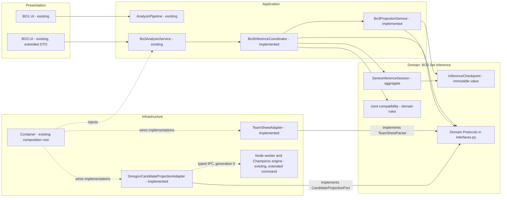
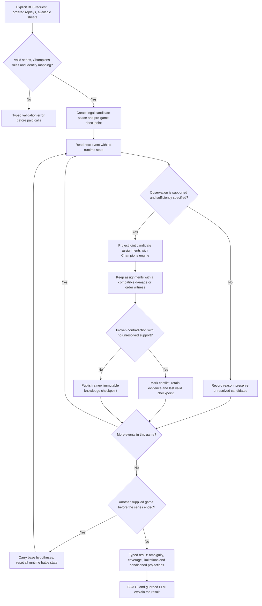

# BO3 set inference: architecture and methodology

Status: **direct-damage core implemented (ADR-044)**. This supporting bounded
context runs exclusively through the explicit BO3 use case, within the existing
application. Stages 1-5 below are implemented for eligible direct damage. Speed,
critical hits, multi-hit inference and held-out accuracy evaluation remain deferred.
The machine-readable companion is [`semantics.yaml`](semantics.yaml).

### Usage

In the BO3 form, expand the inference settings and optionally paste a JSON sheet
using [`example-teamsheet.json`](example-teamsheet.json). Replace names, slots and
species with those in the series. Omitted fields stay unknown; `item: ""` means
confirmed no item. Native `stat_points` fixes only listed axes. An open teamsheet
need not disclose nature or investment. Never label private values public simply
to narrow the search.

Set `registered_team: true` only when the same registered sets apply throughout.
This carries constraints and confirmed original traits, never HP, boosts, consumed
item state or Mega ability state. Without this assertion, candidates reset each
game. Perspective accepts `public`, a player's name, or `analyst`. Private fields
require the corresponding audience; `available_from_game` prevents future leaks.
Choose percent mode for rounded public HP; exact mode requires actual HP values.

From Python, pass `teamsheet` (dict or JSON string) and `InferenceOptions` in
`Bo3AnalysisRequest` to the existing BO3 pipeline. `result.inference` holds typed
checkpoints; `enabled=False` disables the stage. Default budgets: 12,000 assignments
per checkpoint, 120,000 projections overall, 20 seconds and 4,096 cached projections.
Limits are configurable. Exhaustion yields bounded coverage and preserves sound
prior bounds. Samples never prove uniqueness or an exhaustive damage range.

Only sufficiently known event-time conditions constrain candidates. Missing
items/abilities, unmodeled effects, critical hits, multi-hit and variable-power
moves produce explicit exclusions. A direct-move allowlist is required because
compact Dex metadata omits some dynamic callbacks. Unsupported does not mean
impossible. Chaos never fills unknown fields. Historical conditioned projections
use joint examples, marked `sampled` unless all compatible families are covered;
they do not predict an unmodeled future board. No probabilities are claimed.

Rule provenance: [Showdown validation fixes IVs at 31](https://github.com/smogon/pokemon-showdown/blob/master/sim/team-validator.ts),
[format rules set the 66-point budget](https://github.com/smogon/pokemon-showdown/blob/master/sim/dex-formats.ts),
and [calculator controls cap each stat at 32](https://github.com/smogon/damage-calc/blob/master/src/js/shared_controls.js).
The worker reports its installed engine and local rule-profile versions. No
foreign-generation fallback is permitted.

## 1. Product boundary and sources of authority

Infer **Champions stat points and nature**, with intervals and compatible
hypotheses. The installed generation-0 engine fixes IVs and does not use the IV
input to calculate attributes. IV is consequently not a search dimension. The
existing `evs` field is a legacy transport representation; convert stat points to
that representation only at the engine boundary. Do not display legacy EV-scale
values as native Champions investment.

Only Champions rules and Mega Evolution are supported. Missing engine mechanics
mean an unsupported observation, never a fallback to another game's rules.

| Input | Authority | Use |
|---|---|---|
| Validated teamsheet field | Declared fact, with provenance and availability | Fix that field in the candidate space |
| Ordered replay event | Observed fact | Establish action, target, HP change and runtime conditions |
| Versioned Champions rule profile and engine | Calculation authority | Validate legal profiles and generate damage support |
| Chaos distribution | Statistical prior | Prioritize/rank candidates; never make an unknown field a fact |
| LLM output | Explanation | Explain the typed inference result; cannot remove or invent candidates |

A sheet declares only the fields actually provided. An open sheet must not
implicitly disclose nature or investment. A private full team export can fix
those values for its owner, but cannot become information the opponent knew.
Missing sheet fields remain unknown; conflicting declarations become explicit
conflicts instead of being overwritten by a replay or a metagame guess.

## 2. Architectural diagram: dependency direction

Existing components are marked `existing`; the inference context is implemented.
Solid arrows mean code dependencies. Adapters point to the domain-owned ports
they implement. Dotted arrows show composition or an external infrastructure
connection. The dependency graph is not the chronological processing flow.



The existing BO1 `AnalysisRequest`, `AnalysisResult` and damage/speed pipeline
keep their contracts. Use `InferenceOptions` and `Bo3InferenceEvidence` only on the series path. A replay format ending in `bo3` alone does not activate
inference when the user explicitly selected the BO1 use case.

Series-wide set continuity must come from a verified rule profile or an explicit
registered-team declaration. Matching species previews alone does not establish
that hidden spreads stayed the same. Without verified continuity, report that
limitation and keep per-game inference separate instead of intersecting hidden
set hypotheses across games.

`Bo3ProjectionService` creates separate projections conditioned on surviving
hypotheses. It never writes guessed spreads into `GameState` or replaces an
existing neutral matchup verdict. The shared BO1 calculation engine can be
reused through ports without sharing mutable inference state.

## 3. DDD model and ubiquitous language

| Concept | DDD role | Responsibility |
|---|---|---|
| `SeriesInferenceSession` | Aggregate root | Own one series' constraints, candidate relations, checkpoints and revisions |
| `SeriesPokemonId` | Value object | Stable participant plus roster slot, independent of p1/p2, nickname and Mega forme |
| `DeclaredSet` | Value object | Validated sheet fields, source, audience and when each became available |
| `StatPointSpread`, `NatureId` | Value objects | Represent only legal Champions investment and nature |
| `CandidateProfile` | Value object | A possible permanent base set; unknown item/ability fields branch when necessary |
| `BattleObservation` | Value object | One direct hit or eligible speed-order fact, with exact chronology and measurement semantics |
| `RuntimeBattleState` | Value object | HP, stages, field, current item/ability and actual forme at this event |
| `CandidateRelation` | Value object | Joint compatibility between profiles of interacting Pokemon |
| `InferenceCheckpoint` | Value object | Immutable knowledge available at a game/event boundary |
| `ChampionsRuleProfile` | Value object | Versioned caps, total investment budget, legal natures and supported mechanics |
| `JointConstraintSolver` | Domain service | Intersect constraints without discarding relationships between Pokemon |
| `Bo3InferenceCoordinator` | Application service | Sequence parsing, projections, constraint updates and checkpoint creation |

Do not identify a Pokemon by species alone: opposing mirrors must stay separate,
and Mega Evolution must preserve roster identity. Anchor identity to the sheet's
roster slot. If replays and sheets cannot be mapped unambiguously, require an
explicit participant/slot mapping instead of guessing from species or nicknames.

The inference context consumes Battle Reconstruction and Damage & Speed through
published typed contracts. It supplies evidence to BO3 Coaching. It does not own
the log parser, engine mechanics, metagame repository or LLM orchestration.

## 4. Logical diagram: one chronological inference run



New game observations extend the same base-set constraint problem. They do not
copy damage, HP, items currently held, stages, weather or Mega state from the
previous game's runtime. An item stolen during game 1 does not become a permanent
item change in the game 2 base set. Temporary ability changes require the same
separation from the declared initial ability.

## 5. Constraint methodology

Let `Omega0` be all legal joint base-set assignments consistent with declarations
available at the requested checkpoint. Each assignment contains profiles for all
relevant Pokemon. Unknown opposing attacker and defender spreads must be solved
jointly: one observed hit usually cannot identify which side caused the damage.

For a supported observation `o`:

```text
OmegaNext = {assignment in OmegaCurrent |
    exists(engine witness, compatible HP rounding):
        project(assignment, runtime_state(o)) agrees with measured(o)}
```

Apply this intersection only when the engine evaluation and measurement model
are complete for the affected assignments. A projection error or an unexplored
candidate is **unresolved**, not disproven. Per-Pokemon ranges are marginals of
the joint relation; never recombine independently surviving marginals as if every
combination remained legal.

1. **Initialize from legal rules.** Use a versioned Champions rule catalog for
   per-stat caps and the total budget. Do not copy an EV budget from another game.
   Keep every legal profile reachable. Use lazy generation and effective-stat
   equivalence classes to reduce repeated projections; preserve membership so
   identical damage does not falsely imply one exact nature or spread.
2. **Fix declarations with provenance.** Known sheet items, abilities, moves and
   species constrain candidates. Missing fields remain alternatives. If an own
   full export fixes the attacking set, this reduces ambiguity on the opposing
   defender. Preserve the information audience in every explanation.
3. **Extract independent measurements.** Preserve raw HP tokens, numerator,
   denominator and whether the log exposes exact HP or rounded percentages.
   Existing `hp_percent` floats alone cannot recover all original precision.
   Read observed damage from those HP transitions. Never use the current pipeline's projected ranges as observed
   truth. Reuse parser facts through an adapter and validate extraction against
   independent fixtures; runtime code must not import benchmark scripts.
4. **Reconstruct the hit moment.** Include confirmed boosts, weather, terrain,
   screens, spread-target count, Helping Hand, Friend Guard, HP, item effects,
   ability effects and actual Mega forme. Unknown relevant conditions branch or
   make the observation ineligible. Do not call `enrich_set` to silently freeze
   unknown values to the top Chaos choice in the inference path.
5. **Compare integer support and HP semantics.** For exact HP, match a possible
   integer roll. For rounded percentages, test candidate-dependent maximum HP
   against the logging rounding model, rather than subtracting percentages and
   treating the result as exact. A KO is a lower-bound observation; residual
   damage is separate. Model Focus Sash and other survival effects explicitly
   or mark the observation unsupported.
6. **Gate special observations.** Initially admit only direct supported hits and
   explicit measurement kinds. A critical hit, variable multi-hit sequence,
   transformed attributes or an uncertain damage source is excluded with a
   reason until modeled. Ordinary switching or Mega Evolution is not itself a
   reason to discard an otherwise supported hit.
7. **Use speed evidence carefully.** Constrain speed only when priority,
   ordering modifiers, ties and proc effects are accounted for. Earlier action
   alone does not establish a strictly greater speed stat. Define a separate
   eligibility/evaluation strategy and ship it after the direct-damage stage.
8. **Accumulate with causal checkpoints.** For game 2 recommendations, use the
   checkpoint before game 2. A reveal in game 3 may support a separate final
   retrospective review; it cannot rewrite the previously published game 1
   decision-time checkpoint. Public, owner-private and analyst-only knowledge
   remain separate projections of the same evidence ledger.

### Engine contract gap to close first

The existing `DamageResult.damage_rolls` is insufficient for exact inverse
inference: the Node wrapper flattens nested multi-hit arrays, even though its
min/max percentages sum hit extrema. It also does not expose the candidate's
maximum HP or an explicit total-roll semantic type.

Add a domain-owned `CandidateProjectionPort` and a typed `DamageSupport` response
through a new Node IPC command. Return candidate max HP, uncapped integer roll
support, hit semantics and calculation provenance. Reuse the same Champions
engine; do not reimplement its damage formula in Python. Mark multi-hit support
unavailable until total-damage support, per-hit changes and correlations are
represented correctly. Do not interpret a flattened per-hit array as total damage.

The old `CalcEngineAdapter` and `DamageResult` contract can remain stable for BO1.
`CandidateProjectionPort` is justified by these additional inference semantics,
not by a preference for another calculator implementation.

### Ranking and uncertainty

Compatibility is deterministic conditional on modeled rules and inputs. The
actual hidden set remains uncertain. Chaos may order evaluation and rank
surviving candidates; absence from Chaos never proves a candidate impossible.
Do not label a popularity score as a posterior probability or confidence level.
Calibrated probabilities require an explicit likelihood model and held-out
validation, which are outside the first delivery.

Expose outcome and coverage independently:

- Outcome: `not_informative`, `ambiguous`, `identified_within_model`, `conflict`.
- Coverage: `exhaustive`, `bounded`, `unsupported`.
- A bounded search cannot claim identification. Report unresolved regions and
  effective-stat equivalence classes, even when only one evaluated example remains.
- Empty support is a conflict only if no unresolved assignment could explain the
  observation. Do not widen tolerances or replace declarations silently.
- A conflict remains recorded until an explicit input/rule revision resolves it.
  Keeping the last valid checkpoint does not mean silently forgetting the
  conflicting observation when the next event arrives.

Cache projections by engine/rules version, complete candidate assignment and
runtime conditions. Budgets for calls, time and memory must be explicit. Hitting
a budget produces a bounded result, never an apparently exhaustive answer.

## 6. Design patterns and file ownership

| Pattern | Application | Why |
|---|---|---|
| Ports and Adapters / dependency inversion | Protocols in `domain/interfaces.py`; implementations wired in `Container` | Isolate IPC, sheet syntax and storage from rules |
| Specification | Champions legality, declaration consistency and observation eligibility | Make acceptance rules composable and independently testable |
| Strategy | Damage-support evaluation, later speed-order evaluation, optional ranking | Evolve evidence types without branching throughout the orchestrator |
| Factory | Legal candidate-space construction from declarations and a rule profile | Prevent illegal candidate construction and preserve search coverage |
| Memento | Immutable checkpoints plus an append-only evidence ledger | Reproduce the knowledge available before a decision |
| Memoization | Engine projections keyed by all causal inputs and versions | Reduce repeated work without changing inference semantics |

Do not add a database, message bus, event-sourcing framework or repository merely
to satisfy a pattern catalog. Start with request-scoped state. If resumable series
become a requirement, introduce an `InferenceSessionStore` Protocol and explicit
schema/rule/engine-version invalidation then.

```text
src/domain/bo3_inference/
    models.py                 immutable contracts, identity and provenance
    session.py                SeriesInferenceSession aggregate and checkpoints
    candidate_space.py        legal candidate factory and equivalence classes
    constraints.py            specifications and joint compatibility rules
src/domain/interfaces.py      TeamSheetParser, CandidateProjectionPort (includes rules)
src/services/bo3_inference/
    coordinator.py            chronological inference application service
    observation_builder.py    typed observations from existing battle facts
    projection_service.py     projections conditioned on candidate relations
src/adapters/teamsheet/        syntax normalization and field-level provenance
src/adapters/calc/            new candidate-support adapter over existing IPC
src/services/bo3_inference/solver.py bounded joint search and projection budget
src/services/bo3_inference/declarations.py causal declarations and stable identities
src/services/container.py     only composition root
src/services/series_analysis.py BO3-only invocation and typed result integration
src/ui/series.py              candidates, ranges, assumptions and chronology
node_calc/                    additive structured candidate-support IPC command
```

Rule retrieval belongs to `CandidateProjectionPort.rules()`. Optional prior ranking
and persistent session storage have not been introduced.

## 7. Delivery methodology and acceptance gates

| Stage | Deliverable | Acceptance gate |
|---|---|---|
| 1. Rules and sheets | Native stat-point contracts, identity mapping, declared-field provenance and IV policy | Sheet parsing/validation; no guessed private fields; no BO1 contract changes |
| 2. Engine support | Candidate stats/max HP and typed direct-hit damage support | Real-engine fixtures agree with integer rolls; unsupported cases explicit; no foreign-game fallback |
| 3. Single-game inverse inference | Joint candidate constraints and direct-hit observation extraction inside BO3 | A known planted profile remains compatible; incompatible profiles eliminated; ambiguity retained |
| 4. Series chronology | Immutable before/after checkpoints and game resets | p1/p2 swaps, mirrors, Mega identity, changed runtime items and future revelations cannot corrupt prior knowledge |
| 5. Coaching integration | Typed BO3 inference evidence and conditioned projections | Native/LangChain/ADK see the same evidence; LLM cannot invent exact spreads; BO1 output/parity regressions pass |
| 6. Extended evidence and evaluation | Eligible speed constraints; later multi-hit/critical support | Supported mechanisms validated separately; bounded-search and held-out coverage reported honestly |

Use exact private sets as evaluation ground truth, hidden from the inference
input. Measure true-profile retention, reduction of compatible sets, unidentified
equivalence classes, unsupported-observation rate and latency/calc-call budget.
For synthetic fixtures, verify observed HP independently of the extraction path;
engine-generated fixtures alone cannot prove real-game correctness. Supplement
with independently recorded games whose true sets are known. Paid explanation
benchmarks remain separate from deterministic solver validation.

Implementation is recorded in ADR-044. Independent synthetic constraints and
real-engine planted fixtures validate the core. No held-out real-game accuracy
or paid explanation benchmark is claimed.


## 8. Reproducible validation

The [offline testbench](../../scripts/bo3_inference_benchmark/README.md) adds an
independent brute-force oracle and a frozen engine-generated corpus. Run:

```bash
python -m scripts.bo3_inference_benchmark.run --out /tmp/bo3-validation.json
```

The command exits nonzero for failed gates or unavailable infrastructure. CI runs
it on Python 3.12. Inputs and [archived results](validation/README.md) are versioned.
Synthetic retention and engine consistency do not establish held-out accuracy.


### Public-sheet retrieval and necessary local bounds

Pre-battle Showdown `showteam` packed exports are extracted automatically on import
and analysis. Only explicit public item/ability/move/nature fields become facts;
redacted investment remains unknown. `only_game` scopes each public sheet to its
own game. Public and private declarations retain independent provenance and
visibility, and contradictory known fields are refused. Shared official BO3 room
metadata establishes registration continuity without an extra manual assertion.

Protect/Detect and modeled terrain/passive recovery do not disable unrelated
later attacks. Truly unmodeled runtime effects remain explicit exclusions. The
parser uses the correct distinct protocol positions for side and field effects.
Encore, Perish Song counters and observed Follow Me/Rage Powder redirection do
not themselves alter a direct hit's damage formula; they no longer poison later
eligible hits. Perish faints are not used as damage observations. Substitute and
unknown damage-affecting effects still fail conservatively.

If the full Cartesian space exceeds the joint assignment limit, the solver can
exhaustively evaluate one affordable local factor after each game. Observations
with the same Pokemon identities and measured stat axes are evaluated together:
every retained assignment must explain all their rolls, HP rounding and runtime
states. Registered-team continuity permits earlier-game samples; otherwise only
the current game's samples enter a factor. Try a two-sample subset, then individual
factors if the complete group cannot fit the remaining budget. Report exactly the
sample IDs used; a subset never proves compatibility with omitted observations.
The local limit is at most four times `max_assignments`, capped at 100,000; it
shares the global projection/time budgets. Earlier completed proofs are reused in
before-game checkpoints. Partial local searches cannot narrow ranges. Completed
local proofs supply necessary outer bounds while joint coverage stays bounded.
They neither supply fabricated global joint examples nor prove global feasibility.
`local_constraints`, `local_evaluated_assignments` and `necessary_local_bounds`
make that distinction visible. Missing nature remains a dimension of either search,
not a reason to skip otherwise eligible observations.

The default projection budget is 120,000 per request, with the existing 20-second
time limit and 4,096 cache entries. Existing archived synthetic fixtures explicitly
retain their original 30,000-projection settings. The public-series regression
uses a 60-second validation budget and has no hidden investment ground truth.

### Coaching and replay presentation (ADR-048)

The BO3 field uses the existing BO1 battle panel beside the selected game's
review, before the series narrative. Each game retains its turn position without
making another analysis/model call. The latest inference table opens by default.

Numerical investment belongs to these typed tables. The series narrator explains
declared natures, uncertainty and battle adjustments without baseline spreads or
legacy EV conversions. A narrow allocation-notation guard requests one correction
and raises a typed error if the narrator repeats it. This format guard is not a
general natural-language factuality proof; per-game coaching still follows its
existing ground-truth contract. No arbitrary LLM-driven candidate search is added:
the bounded inverse search already calls the deterministic calculator directly.

Real-series protocol regression: `tests/fixtures/series/bo3-public-showteam-2702605271.json`
contains the public sauronMobile vs miro kart ds series, with spectator chat
removed. The actual worker recognizes 4/5/2 eligible samples after normalizing
the optional `move:` prefix on redirection effects and excluding move-choice
restrictions from damage modifiers. Twelve declared natures are recovered in each
game. Hidden investment is unavailable, so sample recovery is not a spread accuracy
measurement. See the [validation notes](validation/README.md).


## 9. Optimized inverse evaluation

Declared nature, item and ability constrain the causal candidate projection; missing
values never become popular metagame guesses. The read-only candidate projection
port uses the same Champions worker as the forward `damage_calc` agent tool. The
inverse search is deterministic and runs before model explanation, so native,
LangChain and ADK receive the same evidence without an LLM choosing the search.
No new unrestricted agent tool or paid-model call is required.

The worker's `calcRolls` path shares the existing rules, Pokemon construction,
field handling and damage calculation, but skips percentage formatting, KO chance
and description generation in the candidate loop. The full calculator API retains
its existing response. An equivalence matrix tests the integer arrays against the
full path across moves, declared items/natures, HP, boosts and field conditions.

The hidden-profile constraint graph is split only at disconnected components.
Combatants joined by any observed hit remain coupled, including reversed roles.
Independent components are solved separately and their compatible-family counts
multiply only when all are exhaustive. Whole compatible examples combine across
disjoint components; marginal ranges never become invented joint solutions.
`search_components` records the decomposition in each checkpoint. A shared
checkpoint assignment allowance and request projection/time limits remain active.
Exhaustive local proofs are prioritized before broader enumeration, and useful
bounds survive a bounded global search.

In an independent synthetic two-pair regression, 66 evaluated assignments replace
1,089 with identical results. With both attacks and defenses unknown, 2,178
assignments replace a 1,185,921-element Cartesian space while preserving each
pair's correlations. These are structural work reductions, not claims of universal
speedup or real-game identification accuracy. Connected, underdetermined battles
can still exhaust budgets and remain ambiguous. Caps remain 32 per stat / 66 total;
IVs remain fixed at 31 and are not inferred.


## 10. Narration recovery (ADR-050)

BO3 coaching receives a projection without numeric investment priors or candidate
allocations; full typed results retain all calculated ranges. After one correction,
repeated allocation prose is replaced wholesale by an explicit notice. The series
and game evidence are preserved rather than losing the analysis to a narrative
format error. Foreign mechanics still fail closed. See [troubleshooting and audit](../troubleshooting.md).
