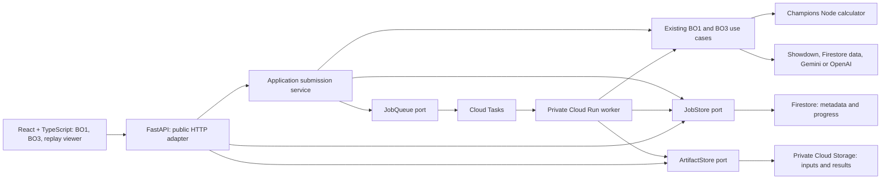

# React migration: beta implementation and rollout gates

Status: local beta implemented, 2026-11-18. The current Streamlit application remains
the production reference until the parity and rollout gates below pass. This
is a presentation and delivery change; it does not change the
Champions rules, BO1/BO3 use cases, inverse solver, or model orchestration.

## Decision and scope

### Local runbook

Install `requirements.txt` and `node_calc` dependencies from the repository
root. Start `python scripts/run_web_local.py`. The launcher uses the project
virtual environment and loads verified Windows system trust before network
SDKs; direct Uvicorn startup can fail TLS validation on intercepted networks.
In `web/`, run `npm ci` and `npm run dev`, then open `http://127.0.0.1:5173`.
Vite proxies `/api/v1` to port 8503. A built frontend (`npm run build`) is
served by FastAPI itself at port 8503 after an API restart. No browser provider
keys or CORS configuration are needed.

`pytest tests/test_web_api.py -q` checks BO1, BO3 2-0, idempotency, quota-free
import, progressive preview and failure retention with fake application
services. It does not establish live model accuracy. Real replay/provider runs
and the held-out BO3 truth corpus remain rollout gates.

Cloud mode uses `PROFESSORVGC_WEB_BACKEND=cloud`. Deploy the same
`Dockerfile.web` image as a public `api` service and a private `worker` service
(`PROFESSORVGC_WEB_ROLE`). Configure Firestore, a private Storage bucket,
Cloud Tasks location/queue, worker URL and task service account through the
`PROFESSORVGC_WEB_*` variables in `.env.example`. Grant the task identity
permission to invoke the worker and the API identity permission to enqueue.
Set worker request and Cloud Tasks dispatch deadlines above measured BO3
latency, bound worker concurrency, enable TTL on conversation/quota documents,
and configure a Storage lifecycle for `web-jobs/`. Cloud cross-service
deployment has not been exercised in this workspace.

Build a React + TypeScript single-page application with Vite. Add a versioned
FastAPI HTTP adapter around the existing Python application services. Run long
analyses in a separate Cloud Run worker, dispatched by Cloud Tasks. Keep the
Champions Node calculator inside the Python worker image. Use Firestore for small
job state and private Cloud Storage objects for replay inputs and result artifacts.
The browser never calls the damage calculator, Firestore, or an LLM directly.

This buys control over the replay viewer, mobile layouts, and progressive result
rendering. It does **not** shorten the damage search or provider calls. Measure
time to first verified result separately from time to complete explanation.

## Target architecture



The arrows are runtime calls. `src/domain/` remains independent of HTTP,
React, Firestore, and Cloud Tasks. `src/services/` owns submission and analysis
workflow. `src/api/` translates HTTP requests to use-case inputs and public
projections. `src/api/jobs.py`, `cloud_jobs.py` and `cloud_queue.py` implement
local and cloud job storage and dispatch. The existing
`src/services/container.py` remains the composition root.

The API and worker can initially share a base container image, since validation
may still need existing adapters. They run as separate Cloud Run services with
different entry points and scaling limits. Serve the built React assets from the
API origin in the first release; this avoids cross-origin credentials and a
second public deployment. A CDN can be added later without changing `/api/v1`.
Keep Streamlit as a separate beta/reference deployment during the transition.

## Public contracts

Do not expose internal `AnalysisResult` or `Bo3AnalysisResult` directly. They
contain orchestration and diagnostic fields that are not stable browser API
contracts. The beta has Pydantic request validation, versioned response
projections and an OpenAPI endpoint; explicit Pydantic response schemas and
generated TypeScript types are a remaining parity gate. React displays numerical inference as
verified ranges and supported exclusions; it never computes or guesses spreads.

| Endpoint | Purpose | Cost and behavior |
|---|---|---|
| `POST /api/v1/bo3/import` | Import public room/game links, order and sheet declarations | Read-only; no quota or model call |
| `POST /api/v1/analyses` | Submit a discriminated BO1 or BO3 request | Validate first; reserve one slot atomically; return `202` and job ID |
| `GET /api/v1/analyses/{id}` | Job status, structured active/completed phases and revision | Small, safe to poll |
| `GET /api/v1/analyses/{id}/preview` | Verified score, inference bounds and damage summary | Available as soon as deterministic BO3 evidence is published |
| `GET /api/v1/analyses/{id}/result` | Final answer and artifact manifest | Available when all required reviews and synthesis finish |
| `GET /api/v1/analyses/{id}/games/{n}` | One game's review and replay snapshots | Fetched only when that game is opened |
| `GET /api/v1/analyses/{id}/evidence` | Filtered/paginated damage citations and tables | Avoids one oversized response |

Submission accepts a tagged union: `{mode: "bo1", replay, question, ...}` or
`{mode: "bo3", games, teamsheet?, inference_options, question, ...}`. Provider,
orchestrator, regulation and BO3 Gemini depth are explicit fields, validated
server-side. A 2-0 BO3 accepts two games. Existing series ordering, player,
format and registered-team checks run before a paid slot is reserved.

The browser creates an `Idempotency-Key` for each Analyze action and reuses it
on network retries. The API scopes the key to the visitor and request hash;
the same key with different input returns `409`. Job creation, ownership and
quota reservation are one Firestore transaction in cloud mode. A failed enqueue
leaves the reserved job queued; retrying the same submission dispatches it
without another quota claim. Once work starts, the current
one-submission/one-slot policy applies even if a provider fails. A browser refresh or
retry must return the existing job instead of charging again.

The beta uses `state`, `stage`, `detail` and `revision`. Richer structured
parallel stage codes remain a parity gate: BO3 game reviews and synthesis
overlap, so one linear stage number cannot represent all work. React preserves
the current meaningful progress text. Poll status every roughly two seconds,
back off when the tab is hidden, and use `revision`/ETag to avoid reloading
unchanged artifacts. Polling is the initial transport; SSE is optional later.

```mermaid
sequenceDiagram
    participant U as React browser
    participant A as FastAPI
    participant Q as Cloud Tasks
    participant W as Analysis worker
    participant S as Job and artifact stores
    U->>A: Import replays, no analysis slot
    A-->>U: Ordered games and public declarations
    U->>A: Submit BO3 with Idempotency-Key
    A->>A: Resolve, validate, reserve quota and create job
    A->>Q: Enqueue job ID
    A-->>U: 202 job ID
    Q->>W: Authenticated task containing job ID only
    W->>S: Persist stage and lease
    W->>W: Inverse inference; publish deterministic callback
    W->>S: Store verified preview and revision
    U->>A: Poll status and preview
    A-->>U: Score, bounds and damage evidence
    W->>W: Parallel game reviews; overlapping series synthesis
    W->>S: Persist final artifacts and terminal state
    U->>A: Fetch result and selected game
    A-->>U: Final explanation and replay view
```

## Reliability and security

- **Worker lifetime:** do not start an unawaited FastAPI background task after
  returning `202`. The Cloud Tasks request remains open while the private
  worker runs. Set bounded application and dispatch timeouts above measured
  BO3 latency, with a worker concurrency limit appropriate for the existing
  three parallel game reviews and four Node table workers.
- **Duplicate delivery:** Cloud Tasks may invoke the same job more than once.
  Claim a short renewable lease with a transactional attempt ID; write stages
  and result manifests idempotently. A retry after an uncertain paid model call
  must not silently call the provider again. Persist safe checkpoints; if the
  call outcome cannot be established, mark the explanation incomplete while
  retaining verified evidence and require an explicit retry policy.
- **Payload size:** Firestore stores only status, ownership hash, progress and
  artifact references. Put submitted logs/teamsheets, full inference tables and
  replay snapshots in private Cloud Storage objects. Enforce request size,
  replay count and artifact expiry at the API boundary.
- **Privacy:** the job belongs to a server-verified anonymous session, not a
  client-supplied visitor ID. Use secure, HttpOnly, SameSite cookies and check
  ownership on every read. Keep provider credentials on the server. Continue
  the current IP-HMAC quota identity behind a trusted proxy while ownership is
  session-based. Do not persist a cross-series spread memory.
- **Retention:** give inputs and results a short published retention period,
  deny API access after expiry, and configure storage lifecycle and soft-delete
  behavior deliberately. Never claim immediate physical deletion from TTL alone.
- **Trust boundary:** preserve Champions-only validation and Mega-only rules in
  the backend. React cannot bypass regulation guards or assert a spread from
  marginal interval endpoints. The worker endpoint accepts authenticated
  Cloud Tasks requests only.

## Frontend composition

Use separate routes and state machines for BO1 and BO3, with shared components
for settings, replay input, battle timeline, citations and error messages.
Suggested structure:

```text
web/src/
  app/                 routing, providers, API client
  features/bo1/        one-game form and result
  features/bo3/        import, series form, preview and game reviews
  features/replay/     battle timeline and field
  features/inference/  point bounds, numeric stats and damage citations
  components/          design-system primitives and loading states
  generated/           OpenAPI types/client; never hand-edit
```

Keep server data in a query cache keyed by job ID and game number. Keep local
view state (selected game, turn, open panels) in React, and mirror only useful
navigation state in the URL. A refresh re-reads the job and restores the view.
The interface first shows imported games, then the deterministic preview, then
per-game and series explanations. An LLM failure retains the preview. Use
semantic HTML, keyboard-operable timeline controls, readable data tables,
responsive layouts, and reduced-motion support.

## Migration sequence and gates

| Phase | Deliverable | Exit gate |
|---|---|---|
| 0. Baseline | Freeze representative BO1 and BO3 fixtures, API-sized output samples, and current timing/UX measurements | Known results, failure modes and quotas recorded |
| 1. HTTP boundary | Public response schemas, FastAPI import/validation/status endpoints, generated TS client | Contract tests; invalid input costs no slot |
| 2. Durable jobs | Job/queue/artifact ports; local adapters; Cloud Tasks, Firestore and Storage adapters | Duplicate submission/delivery, restart and timeout tests; one quota claim |
| 3. BO3 beta | React import, deterministic preview, selected game, explanations and progress | 2-0/2-1 fixtures and partial-failure parity with Streamlit |
| 4. BO1 beta | React BO1 form, viewer and answer | BO1 fixture and regulation parity; no inverse inference |
| 5. Rollout | Mobile/accessibility review, load test, observability, separate beta URL, then controlled traffic migration | No fidelity regression; old UI remains available for rollback |

Record **time to imported games**, **time to deterministic preview**, **time to
complete answer**, frontend render time, job failures and duplicate quota
claims separately. The historical roughly 102-second BO3 measurement is a
backend baseline, not a React performance target. Compare new runs on the same
replays, provider/depth and hardware. Do not remove Streamlit until the held-out
known-spread testbench, replay viewer, 2-0 series, quota behavior, and model
failure recovery all pass on the new interface.

## Platform references

- [Streamlit execution and session state](https://docs.streamlit.io/develop/concepts/architecture/session-state)
- [FastAPI OpenAPI support](https://fastapi.tiangolo.com/features/)
- [Cloud Run request timeouts](https://docs.cloud.google.com/run/docs/configuring/request-timeout)
- [Cloud Run background work guidance](https://docs.cloud.google.com/run/docs/tips/general)
- [Cloud Tasks delivery semantics](https://docs.cloud.google.com/tasks/docs/common-pitfalls)
- [Firestore document size limits](https://docs.cloud.google.com/firestore/quotas)
- [Cloud Storage lifecycle behavior](https://docs.cloud.google.com/storage/docs/lifecycle)
